# Architecture

claude-remote-mcp has three layers. Each runs in a different place, holds its own
state, and reaches the layer below only with that layer's own credential. This page is
the map; the component READMEs have the details.

<picture>
  <source media="(prefers-color-scheme: dark)" srcset="docs/assets/architecture-dark.svg">
  
</picture>

## Interaction layer: the Claude app

The user talks to Claude, often by voice while driving. The connector is added once on
claude.ai by its URL and is then available in every Claude app on the account, including
mobile and CarPlay. Claude decides which tool to call; nothing in this repo runs here.

What this layer imposes on the others:

- **Time.** Voice mode gives up on a tool call after about 30 s, other clients after
  about 60 s. Tools therefore wait at most 20 s, and longer work is followed with
  `wait_for_agent`.
- **Speech.** Replies are read aloud, so tool results are a few short lines of plain
  text, never code or logs.
- **Approval.** Voice mode asks before each tool call unless the tools are set to
  *Always allow* in the connector's settings.

## Orchestration layer: mcp-gateway

An MCP server on an always-on host, reachable from the internet only through a
Cloudflare Tunnel. See [mcp-gateway/README.md](mcp-gateway/README.md).

- **OAuth.** It is its own authorization server for one user: claude.ai registers
  itself, and the user signs in once with a passphrase. Access tokens last an hour and
  refresh tokens 90 days, replaced on every refresh.
- **Authentication.** Every `/mcp` request needs a valid access token. The tunnel only
  publishes `/mcp` and the OAuth paths, and the server only accepts its own hostname and
  requests from claude.ai or claude.com (or with no origin).
- **Tool routing.** The gateway keeps its agent hosts in `bridges.json`, each with its own
  token. An agent id names its host (`mac/w1:p1`, bare while there is one host), and
  each tool becomes a call to that host's agent-bridge. `list_agents` asks every host at
  once, and `start_agent` without a host asks each one for the project
  (`GET /projects/{name}`). Hosts first say about themselves (`GET /info`), and only
  those at the gateway's API version or one behind are called. Arguments (agent ids, prompt length, waits) are
  checked before anything is sent. Project names and paths go to agent-bridge as given:
  it resolves and checks them, and reports each agent's project.
- **Agent operations.** `list_agents`, `agent_details`, `read_output`, `send_prompt`,
  `wait_for_agent`, `answer_agent`, `start_agent`, `rename_agent` and `stop_agent`.
  agent-bridge's JSON comes back as one short line per agent plus the last output lines.

It runs as a single process: sign-ins in progress and the wrong-passphrase counts live in
its memory, and it reads `oauth.json` only at startup.

## Execution layer: agent-bridge and herdr

The machine where Claude Code runs. See [agent-bridge/README.md](agent-bridge/README.md).

- **agent-bridge** is a small HTTP API on the LAN with its own bearer token. It turns
  each request into `herdr` CLI calls and keeps no state of its own.
- **Workspace management.** herdr owns the agents. Each agent started here gets its own
  herdr workspace, named after the agent; renaming renames both. Agents are addressed by
  their herdr pane id, e.g. `w1:p1`.
- **Agent lifecycle.** Start in a project folder (only under the allowed roots, at most
  10 agents, on the Claude account set up for that folder), prompt, wait, answer a
  question, rename, stop. Every agent can be read; only those in allowed folders can be
  changed, including ones started by hand.
- **Claude Code sessions** run in herdr panes, each with its account's Claude config.
  With a trust root and a separate Claude config set, a new agent's folder under the
  trust root is marked trusted in that config, so it starts without Claude's trust
  dialog; the default config is never changed.

## Where state lives

| State | Where |
|---|---|
| The connector's access and refresh tokens | claude.ai |
| Signed-in clients and hashes of their tokens | `oauth.json` on the gateway host |
| Sign-ins in progress, authorization codes, wrong-passphrase counts | mcp-gateway's memory |
| Agent hosts: URL, token and what each last said about itself | `bridges.json` on the gateway host |
| Agents, their workspaces and output | herdr on the agent host |
| Claude logins and trusted folders | each account's Claude config on the agent host |

agent-bridge holds nothing: after a restart it sees the same agents through herdr.

## Trust boundaries

1. **Internet to gateway:** Cloudflare terminates TLS. The tunnel forwards only `/mcp`
   and the OAuth paths, and `/mcp` needs an access token that only the passphrase
   sign-in produces.
2. **Gateway to agent host:** a separate bearer token, over the LAN only. agent-bridge
   isn't reachable from the internet.
3. **agent-bridge to agents:** allowed roots, the agent limit and the trust root bound
   what a request can start or change.

[SECURITY.md](SECURITY.md) says how to report a vulnerability and what is in scope.
