# claude-remote-mcp

[](https://github.com/placheckij/claude-remote-mcp/actions/workflows/ci.yml)
[](https://github.com/placheckij/claude-remote-mcp/security/code-scanning)
[](LICENSE)
[](pyproject.toml)

Voice-driven remote orchestration for Claude Code agents. Manage and supervise AI coding agents from anywhere using natural language.

<picture>
  <source media="(prefers-color-scheme: dark)" srcset="docs/assets/architecture-dark.svg">
  
</picture>

## Components

How the layers fit together, where state lives and the trust boundaries:
[ARCHITECTURE.md](ARCHITECTURE.md). Each component has its own README with system
requirements, configuration, deployment and tests.

| Directory | Runs on | Role |
|---|---|---|
| [`mcp-gateway/`](mcp-gateway/) | an always-on host: a small home server, a VPS, or the agent host itself (Linux, macOS; the setup script needs Debian-based Linux with systemd) | MCP server exposed to claude.ai through a Cloudflare Tunnel; signs the connector in with OAuth (a passphrase) and forwards tool calls to `agent-bridge`. Includes a setup script. |
| [`agent-bridge/`](agent-bridge/) | the machine where herdr and Claude Code run (macOS, Linux or Windows) | Narrow LAN-only HTTP API translating requests into `herdr` CLI calls; keeps only its id and its gateway. Enrolls itself with the gateway. Runs as a launchd or systemd user service. |

You need:

- [herdr](https://github.com/herdrdev/herdr) 0.8.0+ and Claude Code on the agent
  host;
- [uv](https://docs.astral.sh/uv/) on both hosts;
- an agent host that stays awake and logged in while you use it (see
  [Keeping the agent host available](agent-bridge/README.md#keeping-the-agent-host-available));
- a Cloudflare account (the Free plan is fine) with a domain whose DNS is on Cloudflare;
- a Claude plan with custom connectors.

The gateway and the agent host can be one machine.

## Setup order

1. **Cloudflare:** add your domain to Cloudflare if it isn't there yet (its DNS must be
   managed by Cloudflare), and pick a subdomain for the connector, e.g.
   `mcp.example.com`. Nothing else to create by hand: the setup script in step 2 makes
   the tunnel and the DNS record.
2. **Gateway host:** run [`mcp-gateway/deploy/setup.sh`](mcp-gateway/README.md#deploy-with-the-setup-script)
   with that subdomain. On the first run it prints a Cloudflare login URL: open it in
   any browser and pick your domain. It then sets up the service and the
   [Cloudflare Tunnel](mcp-gateway/README.md#cloudflare-tunnel), prints the sign-in
   passphrase, and prints an enrollment string for the agent hosts, good for 30 minutes
   (`sudo mcp-gateway enroll` prints a new one).
3. **Agent hosts:** on a Mac, run
   [`agent-bridge/deploy/macos/setup.sh`](agent-bridge/README.md#with-the-setup-script)
   and paste that string when asked; it installs the service and enrolls it. On Linux,
   [`agent-bridge/deploy/linux/setup.sh`](agent-bridge/README.md#as-a-service-on-linux-systemd-user-unit)
   does the same with a systemd user service. Elsewhere,
   start [agent-bridge](agent-bridge/README.md#run), then
   [enroll](agent-bridge/README.md#enroll-with-the-gateway) it with that string.
4. **claude.ai:** [add the custom connector](mcp-gateway/README.md#add-the-connector-in-claudeai)
   by its URL and sign in with that passphrase.

If you have more than one Claude subscription, e.g. a work and a personal one, agents can
start on the right one for each project folder: see
[Claude accounts](agent-bridge/README.md#claude-accounts).

## Development

uv workspace; each component is its own package.

```sh
uv sync --all-packages
uv run --package agent-bridge pytest agent-bridge
uv run --package mcp-gateway pytest mcp-gateway
```

## License

[MIT](LICENSE)
